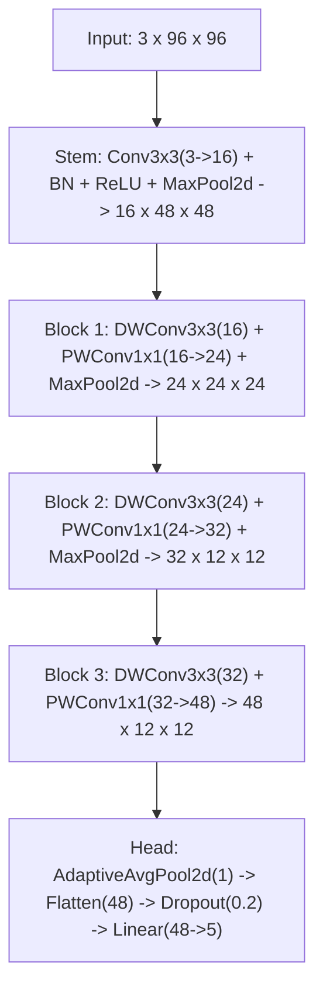

# MiniCADNet

**Miniature Compact Automotive Damage Classification Network** — a lightweight custom CNN designed and trained completely from scratch in PyTorch for 5-class automotive damage crop classification.

---

## 1. Problem Statement
Automated vehicle damage assessment often relies on heavy pretrained backbones or object detectors. **MiniCADNet** explores how small a custom CNN trained from random initialization can be while still learning meaningful visual features for classifying common automotive damage types (`Scratch`, `Dent`, `Broken part`, `Paint chip`, `Missing part`) on `96 × 96` RGB crops.

> [!IMPORTANT]
> **Critical Scope Limitation:** MiniCADNet v1 is trained on **cropped damage regions** and performs single-label image classification. **It does not detect, localize, or draw bounding boxes around damage in full vehicle images.**

---

## 2. Why a Compact CNN Architecture?
- **Minimal footprint:** `4,397` trainable parameters (~`0.017 MB` in FP32).
- **From-scratch training:** No pretrained weights, transfer learning, YOLO, or external model architectures.
- **Depthwise separable convolutions:** Splits spatial filtering (`3×3` depthwise conv, `groups=C`) from channel mixing (`1×1` pointwise conv) to cut parameter count and multiply-adds.
- **Global average pooling:** `AdaptiveAvgPool2d(1)` replaces heavy dense layers, reducing overfitting and keeping the classification head to `48 → 5` (`245` parameters).

---

## 3. Model Architecture (v1)

- **Input:** `3 × 96 × 96` RGB (`float32` normalized to `[0, 1]`)
- **Output:** `5` raw class logits (softmax is applied only during inference/visualization, not inside `forward`)
- **Trainable parameters:** `4,397` (`0` non-trainable)



See [docs/architecture_v1.md](docs/architecture_v1.md) for the full layer-by-layer shape and parameter table.

---

## 4. Dataset & Preprocessing
- **Source:** `DrBimmer/car-parts-and-damage-dataset` on Hugging Face (`Car parts dataset/File1/`, which holds the 814 damage-annotated images in Supervisely polygon format).
- **Crop extraction (`scripts/preprocess.py`):**
  - Converts polygon annotations to bounding boxes with **15% context padding**, clamped to image boundaries.
  - Skips boxes smaller than `16 px` and caps repeated annotations at **5 crops per class per source image** (keeping largest-area instances).
  - Resizes crops to `96 × 96` RGB.
- **Leakage-free split (performed at source-image level BEFORE cropping):**

| Split | Source Images | Crops |
| :--- | ---: | ---: |
| `train` | 566 | 3,140 |
| `val` | 121 | 724 |
| `test` | 122 | 717 |
| **Total** | **809** | **4,581** |

| Class | Train | Val | Test | Total |
| :--- | ---: | ---: | ---: | ---: |
| `Scratch` | 660 | 172 | 156 | 988 |
| `Dent` | 931 | 207 | 219 | 1,357 |
| `Broken part` | 973 | 206 | 207 | 1,386 |
| `Paint chip` | 196 | 54 | 43 | 293 |
| `Missing part` | 380 | 85 | 92 | 557 |

---

## 5. Training Methodology
- **Hardware:** Google Colab GPU
- **Optimizer:** Adam (`lr = 0.001`, `weight_decay = 0.0001`)
- **Epochs:** Up to `25` with early stopping (`patience = 5`)
- **Batch size:** `32` | **Seed:** `42`
- **Class imbalance handling:** Inverse-frequency weighted `CrossEntropyLoss` computed strictly from the `train` split (`[0.9515, 0.6745, 0.6454, 3.2041, 1.6526]`).
- **Data augmentation (`dataset.py`):** Applied **only** to `train` (random horizontal flip, slight brightness/contrast jitter, ±12° rotation). `val` and `test` remain unaugmented.
- **Model selection:** Best checkpoint selected by validation Macro F1 (with validation loss tie-breaker), achieving its best checkpoint at **Epoch 24**.

---

## 6. Evaluation Results (v1 Test Split)

Evaluated once on the held-out `test` split (`717` crops):

| Metric | Value |
| :--- | ---: |
| Test samples | 717 |
| Test accuracy | 53.84% |
| Macro precision | 46.28% |
| Macro recall | 47.45% |
| Macro F1 | 46.63% |

### Per-Class Test Results

| Class | Precision | Recall | F1 |
| :--- | ---: | ---: | ---: |
| `Scratch` | 52.45% | 48.08% | 50.17% |
| `Dent` | 50.00% | 49.32% | 49.66% |
| `Broken part` | 68.93% | 68.60% | 68.77% |
| `Paint chip` | 12.12% | 9.30% | 10.53% |
| `Missing part` | 47.90% | 61.96% | 54.03% |

- When placed in `outputs/plots/confusion_matrix.png`, the confusion matrix visualization can be viewed directly from the outputs folder.

---

## 7. Installation & Usage

### Installation
```bash
git clone <your-repo-url>
cd MiniCADNet
pip install -r requirements.txt
```

### Dataset Preparation
```bash
python scripts/inspect_dataset.py
python scripts/preprocess.py
```

### Training & Evaluation
```bash
python training/train.py
python training/evaluate.py
```

### Streamlit Demo Prototype
Ensure `outputs/checkpoints/best_model.pth` is present, then run:
```bash
streamlit run app.py
```

---

## 8. Limitations & Future Improvements
- **Limitations:**
  - Trained only on cropped damage regions; does not localize damage on full vehicle photos.
  - Severe class imbalance and visual similarity on `Paint chip` (`196` train crops, `10.53%` test F1) limits overall Macro F1 (`46.63%`).
  - Ultra-compact capacity (`4,397` parameters) constrains fine-grained texture discrimination (`Scratch` vs `Dent` vs `Paint chip`).
  - Prototype status only — not ready for production insurance/inspection deployment.
- **Future Improvements:**
  - Increase model capacity moderately (e.g. `15k–50k` parameters) with residual connections or Squeeze-and-Excitation blocks while remaining lightweight.
  - Use higher input resolution (`128 × 128`) and targeted augmentation / focal loss for minority classes (`Paint chip`).
  - Add a two-stage detector + MiniCADNet classifier pipeline for full-vehicle images.
