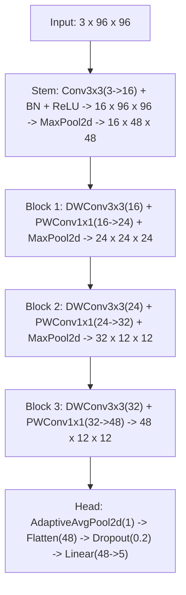

# MiniCADNet Architecture v1

- **Input:** `3 x 96 x 96` RGB
- **Output:** `5` raw class logits (`Scratch`, `Dent`, `Broken part`, `Paint chip`, `Missing part`)
- **Total Parameters:** `4,397`
- **Trainable Parameters:** `4,397`
- **Non-trainable Parameters:** `0`
- **Estimated FP32 Size:** `0.016773 MB` (`17,588` bytes)
- **Pretrained Weights / External Models:** None (100% custom PyTorch `nn.Module` trained from random initialization)

## Architecture Flow

## Layer-by-Layer Summary (Batch Size = 1)

| Layer | Type | Output Shape | Parameters |
| :--- | :--- | :--- | ---: |
| `stem.0` | `Conv2d` | `(1, 16, 96, 96)` | 432 |
| `stem.1` | `BatchNorm2d` | `(1, 16, 96, 96)` | 32 |
| `stem.2` | `ReLU` | `(1, 16, 96, 96)` | 0 |
| `stem.3` | `MaxPool2d` | `(1, 16, 48, 48)` | 0 |
| `block1.block.0` | `Conv2d` | `(1, 16, 48, 48)` | 144 |
| `block1.block.1` | `BatchNorm2d` | `(1, 16, 48, 48)` | 32 |
| `block1.block.2` | `ReLU` | `(1, 16, 48, 48)` | 0 |
| `block1.block.3` | `Conv2d` | `(1, 24, 48, 48)` | 384 |
| `block1.block.4` | `BatchNorm2d` | `(1, 24, 48, 48)` | 48 |
| `block1.block.5` | `ReLU` | `(1, 24, 48, 48)` | 0 |
| `block1.block.6` | `MaxPool2d` | `(1, 24, 24, 24)` | 0 |
| `block2.block.0` | `Conv2d` | `(1, 24, 24, 24)` | 216 |
| `block2.block.1` | `BatchNorm2d` | `(1, 24, 24, 24)` | 48 |
| `block2.block.2` | `ReLU` | `(1, 24, 24, 24)` | 0 |
| `block2.block.3` | `Conv2d` | `(1, 32, 24, 24)` | 768 |
| `block2.block.4` | `BatchNorm2d` | `(1, 32, 24, 24)` | 64 |
| `block2.block.5` | `ReLU` | `(1, 32, 24, 24)` | 0 |
| `block2.block.6` | `MaxPool2d` | `(1, 32, 12, 12)` | 0 |
| `block3.block.0` | `Conv2d` | `(1, 32, 12, 12)` | 288 |
| `block3.block.1` | `BatchNorm2d` | `(1, 32, 12, 12)` | 64 |
| `block3.block.2` | `ReLU` | `(1, 32, 12, 12)` | 0 |
| `block3.block.3` | `Conv2d` | `(1, 48, 12, 12)` | 1,536 |
| `block3.block.4` | `BatchNorm2d` | `(1, 48, 12, 12)` | 96 |
| `block3.block.5` | `ReLU` | `(1, 48, 12, 12)` | 0 |
| `head.0` | `AdaptiveAvgPool2d` | `(1, 48, 1, 1)` | 0 |
| `head.1` | `Flatten` | `(1, 48)` | 0 |
| `head.2` | `Dropout` | `(1, 48)` | 0 |
| `head.3` | `Linear` | `(1, 5)` | 245 |
